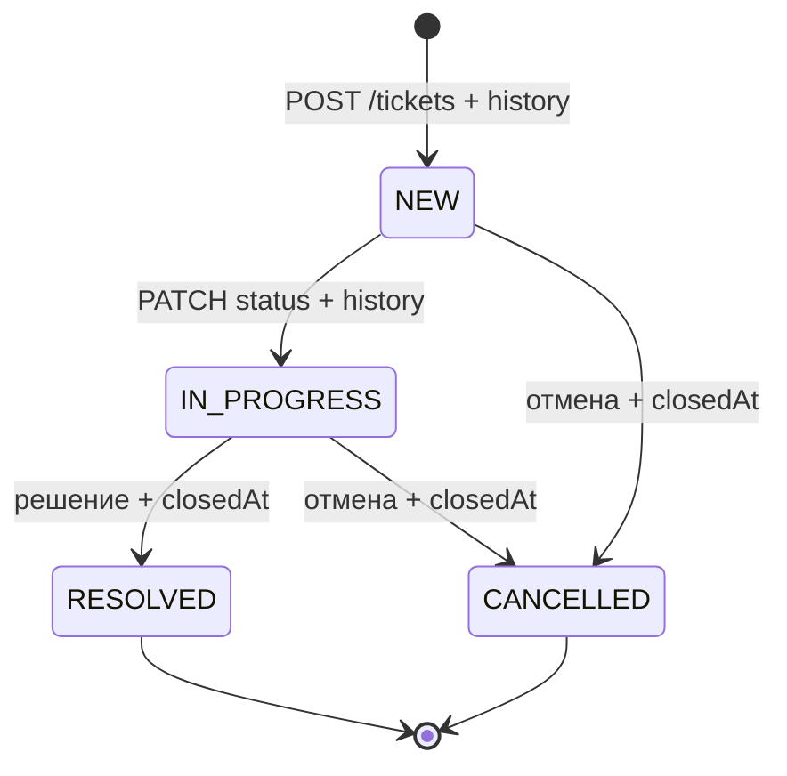
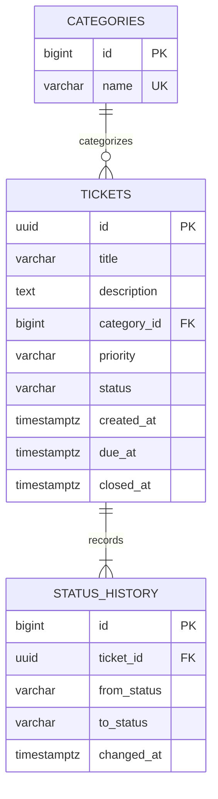

# Спецификация

## Проблема, пользователи и границы

Обращения теряются между каналами; статусы и сроки учитываются вручную. Оператор регистрирует обращения и назначает параметры; специалист ведёт работу; руководитель смотрит статистику. Роли описывают пользователей, разграничение доступа в учебном API не реализуется. Один сервер хранит заявки, категории и неизменяемую через API историю в PostgreSQL. Подключение почты/мессенджеров, UI, микросервисы, Kubernetes и персональные данные пользователей исключены.

## Истории и проверяемая приёмка

| ID | История | Критерии приёмки |
|---|---|---|
| US1 | Как оператор, регистрирую заявку, чтобы не потерять обращение | Валидный POST возвращает 201, Location, UUID и NEW; пустой заголовок/отсутствующая или неизвестная категория → 400; начальная запись истории сохраняется |
| US2 | Как специалист, открываю заявку по ID | Существующая → 200 и сохранённые поля; неизвестный UUID → 404 |
| US3 | Как оператор, уточняю описание, приоритет и срок | Открытая заявка изменяется через PUT; LOW/MEDIUM/HIGH допустимы, неизвестное значение → 400; null срока удаляет срок; закрытая/отменённая → 409 без изменений |
| US4 | Как специалист, веду заявку по этапам | NEW → IN_PROGRESS → RESOLVED; NEW/IN_PROGRESS → CANCELLED; прочие переходы, включая повтор того же статуса → 409; конечные статусы устанавливают closedAt |
| US5 | Как руководитель, проверяю историю | GET history содержит создание и каждый успешный переход по порядку; при отказе новая запись не появляется; ошибка записи истории откатывает статус |
| US6 | Как оператор, нахожу нужные заявки | Совместные фильтры status/priority/categoryId/overdue, page ≥ 0 и size 1..100; ответ содержит totalElements; стабильный порядок createdAt,id; неверные параметры → 400 |
| US7 | Как руководитель, получаю статистику периода | Одна выборка createdAt ∈ [from,to); текущие статусы/приоритеты, количество, просроченные и средняя длительность RESOLVED; пустое среднее → null; from ≥ to → 400 |
| US8 | Как оператор, выбираю категорию из справочника | GET categories возвращает три мигрированные категории и ID, принимаемые POST |

## Функциональные требования

FR1 создание и чтение (US1–2); FR2 редактирование (US3); FR3 конечный автомат (US4); FR4 транзакционная история (US5); FR5 поиск и пагинация (US6); FR6 Kotlin-отчёт (US7); FR7 категории (US8); FR8 единые ошибки 400/404/409. Название обязательно и ≤200 символов; описание обязательно, может быть пустым, ≤10000 символов. Приоритет обязателен. categoryId — существующий ID. dueAt необязателен, может быть в прошлом: такие обращения сразу видны как просроченные. Статус и createdAt клиентом не задаются. RESOLVED считается завершённым, CANCELLED — отменённым; оба терминальные, closedAt устанавливается сервером. Все времена — ISO-8601 Instant UTC. История включает создание с fromStatus=null. Удаление заявок не предусмотрено.

Просрочка: dueAt < Clock.instant(), статус NEW либо IN_PROGRESS. При точном равенстве срока и текущего времени заявка ещё не просрочена. Статистика считает текущее состояние заявок, созданных за период; это не исторический срез на дату to. Среднее в секундах с дробной частью, только RESOLVED: closedAt − createdAt. Каждая категория enum присутствует с нулём при отсутствии данных.

## Нефункциональные требования

NFR1 воспроизводимый запуск — Wrapper, фиксированные версии и Compose; проверка в чистой CI-среде. NFR2 сохранность — именованный том, проверка пересоздания контейнеров и восстановления в отдельную БД. NFR3 все ошибки API содержат timestamp/status/message/path; stack trace клиенту не выдаётся. NFR4 реальные секреты только в окружении/CI secrets, .env исключён из Git. NFR5 Clock управляется в тестах, тесты очищают данные, не зависят от порядка. NFR6 строковая блокировка сериализует одновременные правки; статус и история атомарны. NFR7 health/readiness проверяет БД, логи stdout/stderr; приложение не требует локальных файлов данных. NFR8 CI блокирует доставку при ошибке тестов. Нагрузочный SLA в ТЗ не задан; отчёт строится в памяти по одной выборке и предназначен для учебного объёма данных.

## Процесс

Проверка входных данных → поиск и блокировка заявки → проверка перехода → обновление → запись истории → commit → ответ. При ошибке обновления/истории — rollback. При запрещённом переходе — 409 до записи.

## ER

Категории неизменяемы через API. FK исключают потерю связности. Индексы обеспечивают выборку периода, фильтрацию и историю. Миграция V1 создаёт схему и справочник; демонстрационные заявки загружаются отдельно.
